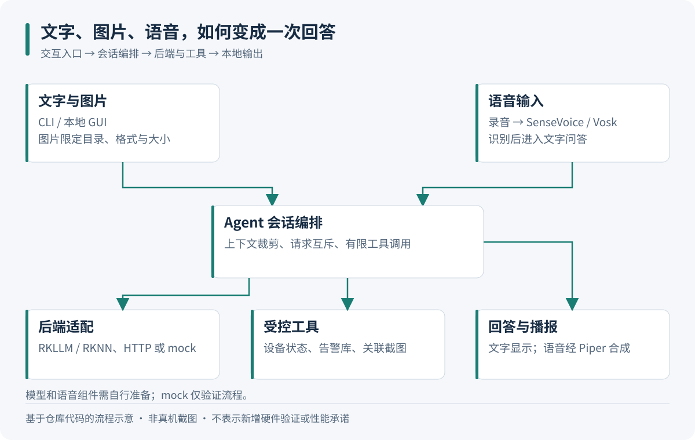
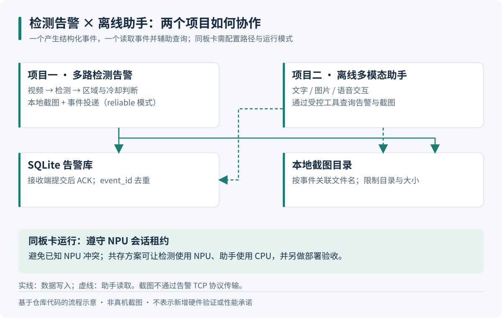
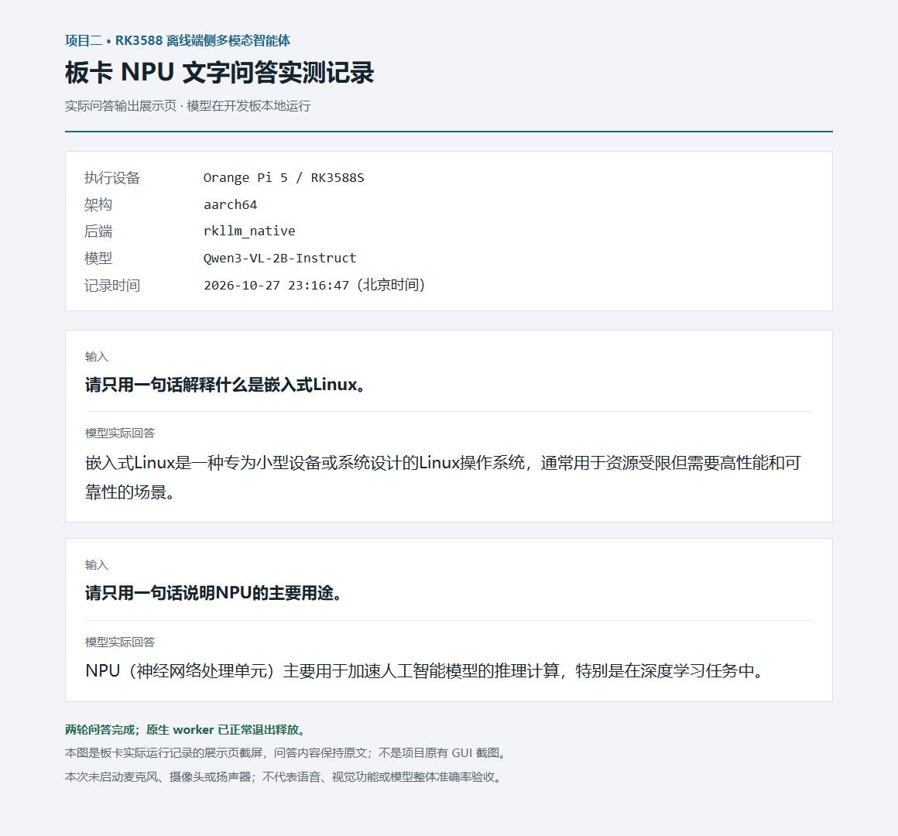
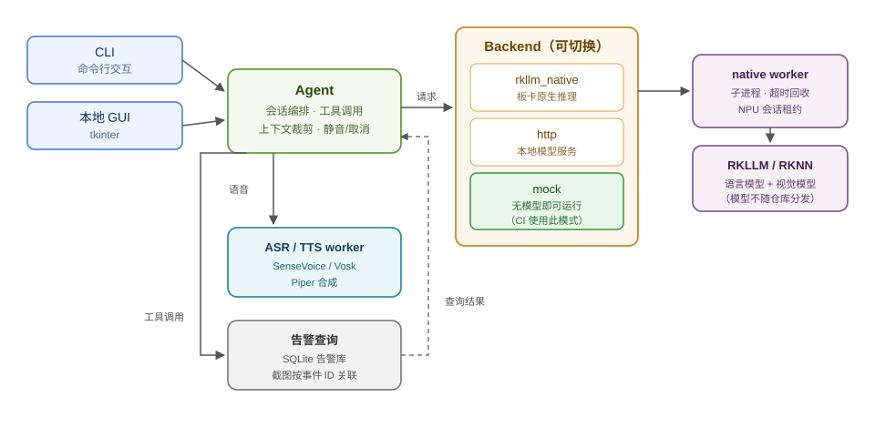

# RK3588 离线端侧多模态智能体

[](https://github.com/3355-del/rk3588-offline-agent/actions/workflows/ci.yml)

在 RK3588（Orange Pi 5）板卡上**完全离线**运行的多模态助手：支持**文字、图片、语音**三种输入，本地完成语音识别、语言模型推理与语音合成，**不调用任何云端 API**；还能用自然语言查询另一个边缘检测项目的告警记录与截图。

## 图解：交互与双项目协作

下面两张图按当前源码绘制，便于理解输入、处理和数据流；它们是**流程示意，不是真机界面截图**。原有性能记录与已知边界仍见下文。

### 从输入到回答



普通问答由后端处理；设备状态和部分告警查询可以走直接工具路径。图片先检查目录、格式和大小，语音需安装对应识别与合成组件。不同后端能力以实际配置为准，mock 不代表运行了真实模型。源码：[会话编排](edge_agent/agent.py)、[语音工作进程](edge_agent/voice_worker.py)。

### 与检测系统共享告警信息



检测系统负责产生事件，助手负责按条件查询事件并关联截图。使用前需配置同一告警库和截图路径；SQLite 使用只读连接，截图读取受目录边界与大小限制。两者的 NPU 同时运行安全性并未得到保证，已有 CPU/NPU 分工方案。源码：[告警查询与截图读取](edge_agent/alarms.py)；配套项目：[多路检测告警系统](https://github.com/3355-del/rk3588-multi-stream-alarm)。

## 板卡文字问答运行记录



2026-10-27 在开发板上通过项目的 `Agent.ask` 执行两轮文字问答，后端为 `rkllm_native`，模型为 Qwen3-VL-2B-Instruct；实际原生 worker 已核实运行，测试后正常退出释放。图中问题与回答保持原文，展示页用于整理本次运行记录，**不是项目原有 GUI 截图**。本次未启动麦克风、摄像头或扬声器，也不作为语音、视觉或整体准确率验收。

见 [本次原始问答记录](docs/board-text-run-20261027.json)。板卡模型和依赖就绪后，可使用 `bash scripts/run_linux.sh --npu chat` 输入图中相同问题复核；模型生成结果可能随上下文和运行配置变化。

## 它解决什么问题

- **隐私不出设备**：录音、图片、对话全部在板卡本地处理，不上传云端
- **无网可用**：弱网、断网、内网环境同样能跑
- **无按次费用**：不消耗云端 token/API 额度
- **打通两个系统**：车 / 园区监控只报警不够，这里可以用"今天有没有人闯入"这类自然语言直接查告警库并调出截图

## 主要功能

- **三种交互入口**：命令行与本地 GUI；文本问答、图片问答（视觉模型）、语音问答（识别 → 推理 → 播报）
- **模型常驻复用**：会话进程内复用模型，避免逐次加载；超时/取消后回收子进程并按需重建
- **离线语音链路**：SenseVoice / Vosk 识别 + Piper 合成，串联录音、识别、生成、播放；含静音保护与重录流程
- **告警联动**：按事件 ID 关联告警库与截图，支持自然语言查询
- **NPU 资源保护**：跨进程会话租约，在 SDK 初始化前拒绝冲突并提示 CPU 回退，避免与同板卡其它 NPU 任务互相打崩
- **可无模型运行**：内置 `mock` 后端，在没有模型、没有板卡的机器上也能跑通完整交互链路（CI 即用此模式）

## 架构

```
            ┌─────────────── CLI / 本地 GUI ───────────────┐
            │                                              │
            ▼                                              ▼
   Agent（工具调用 / 会话编排）                    ASR / TTS worker
            │                                      （SenseVoice / Vosk / Piper）
            ▼
   Backend  ┬─ rkllm_native  → native worker → RKLLM（语言）+ RKNN（视觉）
            ├─ http           → 本地 llama.cpp / 兼容 OpenAI 接口的服务
            └─ mock           → 桩实现（无模型，CI 与本地演示用）
            │
            └─→ alarms：查询边缘检测项目的告警库与截图（SQLite）
```



## 实测数据（板卡实测，非估算）

| 指标 | 结果 | 说明 |
|---|---|---|
| 文本请求耗时 | **3.668 s → 0.489 s** | 模型逐次加载 → 会话内常驻复用；固定输入、64 Token 上限、去掉首轮后取 3 次中位数 |
| 图片问答耗时 | **9.456 s → 4.399 s** | 同上对照 |
| NPU 独占长稳 | **约 1 小时 / 3345 次请求**（3010 文本 + 335 视觉），`errors=[]` | RSS 3.07–3.08 GiB，温度峰值 55.5 °C，模型按预期回收 |
| 与另一项目共存 | 约 1 小时（3612 s），**1051 次请求无错误** | 本项目走 CPU、另一项目用 NPU |
| 本机单元测试 | **53 项：47 项通过、6 项按平台跳过** | 下方记录为 `Ran 53 tests`、`OK (skipped=6)`；跳过项不计为通过 |

> 说明：上述耗时为特定输入下的请求耗时，不代表通用生成速度；长稳测试不含外设持续采集。

## 运行环境

| 项 | 版本 |
|---|---|
| 板卡 | Orange Pi 5（RK3588S，**8 GB**） |
| 系统 | Ubuntu 22.04.5 LTS（aarch64） |
| 内核 | 6.1.99-rockchip-rk3588 |
| RKLLM Runtime | 1.1.4 |
| rkllm-toolkit | 1.2.3 |
| 模型规格 | max_context_limit 4096，npu_core_num 3，W8A8 |
| Python | 3.12 |

## 快速开始（不需要模型，也不需要板卡）

```bash
python -m pip install -r requirements.txt

# 交互式演示（mock 后端，纯本地桩实现）
python -X utf8 -m edge_agent --config config/mock.json demo

# 单元测试
python -X utf8 -m unittest discover -s tests -v
```

`config/mock.json` 只依赖标准库与 Pillow；没有模型时用 `mock` 后端验证业务流程、工具调用与告警查询。

### 运行示例（真实输出）

```text
$ python -X utf8 -m edge_agent --config config/mock.json demo

用户：你好
助手：[模拟模式] 已收到：你好。当前用于验证交互流程，尚未运行真实语言模型。

用户：查看设备状态
助手：{
  "os": "Windows",
  "architecture": "AMD64",
  "backend": "mock",
  "model": "rkllm",
  "ffmpeg_available": true,
  "camera_config": "",
  "sensors_started": false,
  "board_model": null,
  "memory_total_mib": null
}

用户：查询最近告警
助手：项目一告警数据库尚未创建
```

```text
$ python -X utf8 -m unittest discover -s tests

............................................ssssss...
----------------------------------------------------------------------
Ran 53 tests in 5.312s

OK (skipped=6)          # 6 项为仅在 Linux 上运行的用例（进程组 / g++ 编译租约测试）
```


## 真机部署（需要模型）

本仓库**不包含模型文件**，需自行准备并放到 `models/`：

| 用途 | 期望文件 |
|---|---|
| 语言模型 | RKLLM 格式（如 `models/rk3588/llm.rkllm`） |
| 视觉模型 | RKNN 格式（如 `models/rk3588/vision.rknn`） |
| 语音识别 | Vosk 中文小模型 / SenseVoice 模型目录 |
| 语音合成 | Piper 语音包 |

步骤概要：

```bash
# 1) 原生层编译（需自行获取 librkllmrt.so / librknnrt.so，仓库不提供二进制）
cmake -S native -B native/build -DCMAKE_BUILD_TYPE=Release
cmake --build native/build -j"$(nproc)"

# 2) 按需修改配置中的模型路径与后端
#    config/rk3588-native.json（板卡原生推理）
#    config/linux-cpu.json（先用 CPU 跑通链路）

# 3) 启动
python -X utf8 -m edge_agent --config config/rk3588-native.json chat
```

`scripts/` 下提供部署与校验脚本：`bootstrap_linux.sh`、`setup_sensevoice.py`、`setup_piper.py`、`check_npu_board.py`、`check_joint_soak.py` 等。

## 已知边界（请先读这一节）

- **使用已导出的模型**，未自行做量化/转换流程
- **语音识别存在漏词**：用固定原录音复现，靠更换识别后端与静音保护缓解，未彻底解决
- **双 NPU 并行冲突的根因未定位**：只实现了跨进程互斥/租约来避免已知冲突
- **长稳测试不含外设持续采集**（不含长时间麦克风/摄像头采集）
- 本仓库**不含任何模型权重、录音与日志**；`data/` 与 `inputs/` 需自行生成

## 目录结构

```
edge_agent/     Python 业务层：会话编排、工具调用、后端适配、语音、告警查询、GUI
native/         C++ 原生推理层（RKLLM / RKNN），不含厂商二进制
scripts/        部署、校验、长稳与压测脚本
tests/          单元测试（53 项，可在无模型环境运行）
config/         示例配置（mock / linux-cpu / rk3588 / rk3588-native）
docs/           部署与验收记录、问题排查、共存说明
```

## 许可

MIT，见 [LICENSE](LICENSE)。`native/rkllm.h`、`native/rknn_api.h` 来自 Rockchip SDK，版权归 Rockchip 所有；模型权重不随仓库分发，各模型遵循其原始许可。
