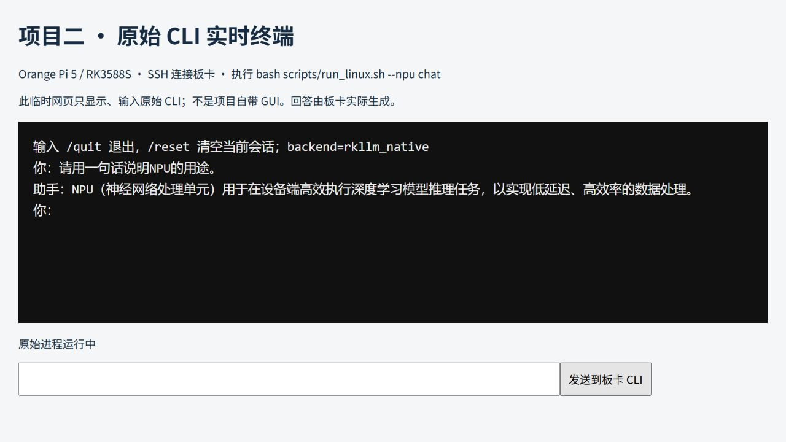
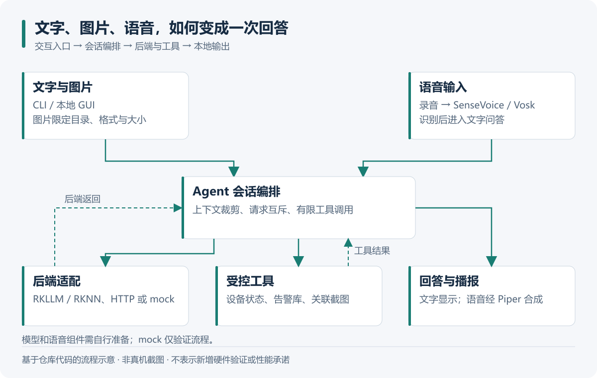
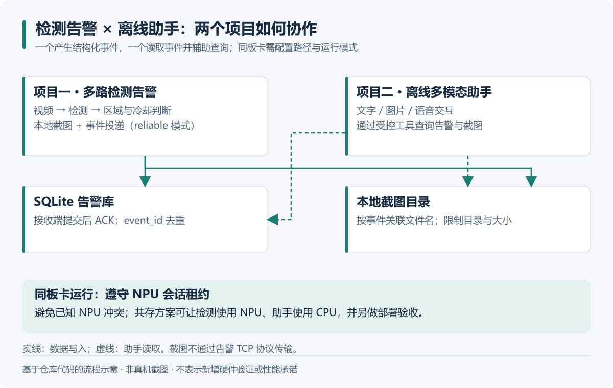
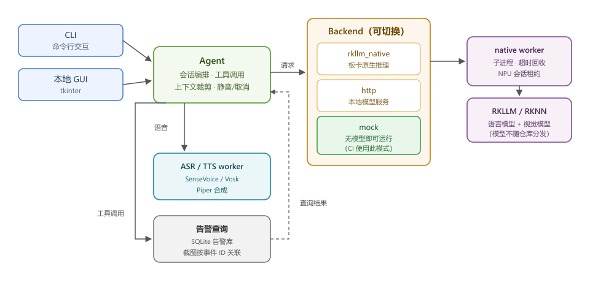

# RK3588 离线端侧多模态智能体

[](https://github.com/3355-del/rk3588-offline-agent/actions/workflows/ci.yml)

一个跑在 Orange Pi 5 上的离线助手：可以打字问答、拍照提问、录音提问并播报回答，也能查[视频告警项目](https://github.com/3355-del/rk3588-multi-stream-alarm)的 SQLite 事件和对应截图。Python 负责业务与设备交互，C++ 接入 RKLLM、RKNN，模型在板卡本地运行。

## 先看运行效果



这是执行 `bash scripts/run_linux.sh --npu chat` 后的原始 CLI。板卡没有显示器，截图时用了临时网页终端转发 SSH 输入输出。输入的问题是“请用一句话说明NPU的用途。”，退出命令是 `/quit`。[完整运行记录](docs/board-run-20261030.md)

## 日常怎么用

| 输入 | 处理过程 | 结果 |
| --- | --- | --- |
| 文字 | Agent 编排会话，调用语言后端或受控工具 | 文字回答、设备状态、告警查询 |
| 图片 | 校验文件与目录，视觉编码后进入图文推理 | 图片描述或问答 |
| 录音 | 录音、语音识别、生成回答、语音合成 | 文字和音频 |
| 告警事件 ID | 只读查询 SQLite，校验截图路径 | 同一事件的记录与图片 |

入口是 CLI 和本地 GUI。普通对话走模型；设备状态和部分告警查询可直接走工具。语音识别接 SenseVoice 或 Vosk，播报接 Piper。后端也保留本地 HTTP 服务和 `mock`，便于先排查业务流程。



业务代码从 [agent.py](edge_agent/agent.py) 看起；语音编排在 [voice_worker.py](edge_agent/voice_worker.py)，告警读取在 [alarms.py](edge_agent/alarms.py)。

## 和视频告警项目如何配合

检测程序负责写入事件和截图，这个项目读取同一数据库。用户输入事件 ID 后，按 ID 查询记录，再从允许的截图目录取图。配置时需要把两边的数据路径接到一起。



部署时采用两种方式：本项目单独用 NPU；或者检测项目用 NPU、本项目用 CPU。启动前通过跨进程租约协调资源，锁跟随模型上下文持有，进程退出时释放。

## 排查记录

### 常驻模型解决了重复加载

对照过逐次加载和会话内常驻两条路径。固定输入、输出上限 64 Token，去掉首轮后取三次中位数：文字请求从 3.668 s 降到 0.489 s，图片请求从 9.456 s 降到 4.399 s。

现在同一会话复用模型；退出时释放。取消或超时后回收子进程，下次请求重新加载。相应处理在 Python 后端与 native worker 之间，测试还会检查子进程能否退出。

### 双 NPU 会话冲突后，锁改为覆盖模型生命周期

两个项目同时持有 NPU 模型时，板卡出现过推理超时、IOMMU 域切换错误和 DMA 分配问题。尝试过请求级串行，仍然失败。随后改成在 SDK 初始化前检查会话租约：检测项目共享锁，助手 NPU 会话独占锁；冲突时提示先关闭另一个会话或切换 CPU。

现有复现、日志线索和运行方式放在[共存说明](docs/双项目共存与NPU冲突说明-20261003.md)。这个保护只协调接入租约的进程。

### Windows 上两项资产保护测试失败

测试替换了项目根目录，但临时根没有 `resolve()`；待检查的路径已经规范化，两边比较时提前触发目录越界检查，导致测试没有走到“已有文件不可覆盖”的分支。修正测试临时根后，Ubuntu 和 Windows CI 都通过，生产路径保护没有放宽。[改动位置](tests/test_assets.py)

另外核对部署环境时，发现 README 的 Runtime 1.1.4、Python 3.12 与实际板卡不符。读取已部署库的 SDK 标识和虚拟环境版本后，改为 RKLLM 1.3.0、Python 3.10.12。

## 测试结果

| 测试 | 结果 | 条件 |
| --- | --- | --- |
| 会话常驻：文字 | 3.668 s → 0.489 s | 固定输入、64 Token 上限，去掉首轮后三次中位数 |
| 会话常驻：图片 | 9.456 s → 4.399 s | 同上 |
| NPU 独占长稳 | 约 1 小时，3345 次请求，`errors=[]` | 3010 次文字、335 次视觉；RSS 3.07–3.08 GiB，温度峰值 55.5°C |
| 与检测项目共存 | 3612 s，1051 次请求无错误 | 助手走 CPU，检测走 NPU |
| Windows 本机单元测试 | 53 项，47 通过、6 跳过 | Linux 专用用例在 Windows 跳过 |

当前 [CI](https://github.com/3355-del/rk3588-offline-agent/actions/workflows/ci.yml)同时检查 Ubuntu 24.04 和 Windows。

## 代码结构

```text
CLI / 本地 GUI
  ├─ Agent：会话、工具调用、文件检查
  ├─ ASR / TTS worker：SenseVoice、Vosk、Piper
  └─ Backend
       ├─ rkllm_native → C++ worker → RKLLM（语言）+ RKNN（视觉）
       ├─ http         → 本地 llama.cpp 等兼容服务
       └─ mock         → 无模型的流程演示

alarms → 只读 SQLite + 受目录限制的截图读取
```



| 目录 | 内容 |
| --- | --- |
| `edge_agent/` | Python 业务层、后端适配、语音和 GUI |
| `native/` | C++ 推理适配与 NPU 租约 |
| `scripts/` | 部署、自检、模型安装和长稳测试 |
| `tests/` | 无模型回归测试 |
| `config/` | mock、CPU 和板卡示例配置 |
| `docs/` | 启动手册、排查及验证记录 |

## 在电脑上先跑起来

```sh
python -m pip install -r requirements.txt
python -X utf8 -m edge_agent --config config/mock.json demo
python -X utf8 -m unittest discover -s tests -v
```

这个入口运行 `mock` 后端。例如输入“你好”，会返回带有“模拟模式”标记的回复；输入“查看设备状态”会读取当前运行电脑的本地状态。接板卡之前可以用它检查配置、工具调用和告警库路径。

## 部署到板卡

当前部署环境：

| 项目 | 版本或配置 |
| --- | --- |
| 板卡 | Orange Pi 5，RK3588S，8 GB |
| 系统 | Ubuntu 22.04.5 LTS，aarch64 |
| 内核 | 6.1.99-rockchip-rk3588 |
| RKLLM Runtime | 1.3.0，2026-10-30 读取部署库标识 |
| rkllm-toolkit | 1.2.3 |
| 模型配置 | W8A8，max_context_limit 4096，npu_core_num 3 |
| Python | 3.10.12，板卡 `.venv-linux` |

准备以下资产，路径与配置保持一致：

| 用途 | 文件位置示例 |
| --- | --- |
| 语言模型 | `models/rk3588/llm.rkllm` |
| 视觉模型 | `models/rk3588/vision.rknn` |
| 语音识别 | Vosk 中文模型或 SenseVoice 模型目录 |
| 语音合成 | Piper 语音包 |
| 原生运行库 | `native/lib/librkllmrt.so`、`native/lib/librknnrt.so` |

在 ARM64 Linux 板卡上执行：

```sh
cmake -S native -B native/build -DCMAKE_BUILD_TYPE=Release
cmake --build native/build -j"$(nproc)"
# 修改 config/rk3588-native.json 中的模型和设备路径
python -X utf8 -m edge_agent --config config/rk3588-native.json chat
```

`scripts/bootstrap_linux.sh` 准备环境；`setup_sensevoice.py`、`setup_piper.py` 安装语音组件；`check_npu_board.py` 和 `check_joint_soak.py` 做板卡与共存验证。逐步操作见[启动手册](docs/操作手册-启动与板卡交互.md)。

## 许可

自有代码使用 [MIT](LICENSE)。`native/rkllm.h`、`native/rknn_api.h` 来自 Rockchip SDK，版权归 Rockchip 所有；模型与运行库按各自许可使用。

## 还没解决的部分

- 双 NPU 并行冲突的根因没有定位。当前会话租约用于拒绝已知冲突组合，能稳定运行的共存方式是 CPU/NPU 分工。
- 语音识别仍有漏词和同音字错误；换后端与静音保护缓解了部分情况。最新截图只验证文本 NPU 问答，本轮语音听感验收暂缓；长稳数据也不包含外设持续采集。
- 使用的是已导出的模型，未自行完成模型量化转换；仓库不提供权重、运行库、原始录音或日志，`data/`、`inputs/` 由运行时生成。
- 延迟和长稳结果对应固定输入与当时的模型、运行环境，不代表任意问题的生成速度或回答正确率。表内 Runtime、Python 是当前部署版本，历史测试沿用其原记录条件。
- 顶部截图来自临时网页终端，其余三张是流程图；仓库自身的交互入口是 CLI 和本地 GUI。
